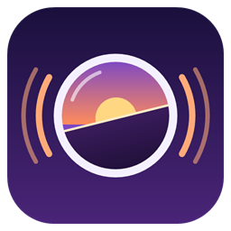

<p align="center"></p>

# Living Camera (Horizon native mod)

A camera that moves with you. It leans into strafes, tips as you jump and fall, sways on fast turns, dips when you
land, bobs with your steps and breathes while you stand still. Everything runs on springs, so the camera eases into
each motion and settles back with a little weight instead of snapping. Every effect has its own strength.

Client side only: it works in single player and on any server, and the server never knows.

## Effects

| Effect | What it does | Default |
|---|---|---|
| Strafe lean | Rolls the camera into sideways movement | 100% |
| Forward lean | A slight tip forward while running | 100% |
| Turn sway | Fast mouse turns tilt the view | 100% |
| Jump and fall tilt | The view lifts going up and dips coming down | 100% |
| Landing dip | A hard landing bumps the camera down; it springs back | 100% |
| Damage shake | Getting hit jolts the camera, harder for bigger hits, and it rings out | 100% |
| Step bob | A soft bounce and sway in step with your walking, on top of vanilla's | 50% |
| Idle breathing | A slow rise and fall while standing still | Off |
| Speed FOV | The view widens past walking speed, up to 15% | Off |
| Hand sway | The held item lags behind fast turns and leans with the camera | 100% |

## Settings

Options > Mods > Living Camera > Settings. Each button steps through its values.

- **Living Camera**: ON / OFF, everything at once.
- **Preset**: one click sets the effects, smoothness and bounce, then fine-tune anything (the preset then reads
  *Custom*):

  | Preset | Feel |
  |---|---|
  | Subtle | A light touch: half-strength lean and sway, a little bob |
  | Default | The defaults below |
  | Cinematic | Stronger lean and sway, floaty springs with more bounce, breathing and speed FOV on: for videos |
  | PvP | Few distractions: small lean, no bob or tilt, snappy springs, a steady view while aiming |

- **Overall intensity**: 25% to 300%.
- **Each effect above**: OFF, 25, 50, 75, 100, 150 or 200%.
- **Smoothness**: Snappy, Normal, Smooth or Floaty (how quickly the camera follows).
- **Bounce**: None, Low, Normal, High or Very high (how much it overshoots before settling).
- **While swimming / While flying (creative)**: how much of the effects stay, OFF to 100%.
- **While riding mounts**: horses, camels and other living mounts, OFF to 100% (default 75%).
- **While aiming (bow, spyglass)**: how much stays while you draw a bow or look through a spyglass, so your aim is
  steady, OFF to 100% (default 25%).
- **Fade out when fast**: Never, or above 10, 12, 16 or 24 blocks a second. Elytra flight, boats and minecarts fade
  the effects out, so the mod stays out of the way of flight mods such as Gyro.
- **Lean direction**: Normal or Inverted.
- **Reset to defaults**.

A **Toggle Living Camera** key turns the mod on and off in game; it starts unbound, set it in Options > Mods. Horizon
also scales camera motion by Accessibility > **Distortion Effects**: at 0% the camera effects disappear.

## Install

In the Horizon launcher: Mods, find **Living Camera**, Install, then **Build**. To try a local copy, put the `.hnmod`
in your instance's `horizon-native-mods/` folder and Build.

## Compatibility

It uses only Horizon's native hook points and needs hook API **369** or later (`compatibility.json`), so the launcher
builds it on any Horizon that has them. Last tested on Nightly `fdc87ae` (2026-11-08) with horizon-mixins `5a64af9`.
Camera shakes from other mods add up with this one.

## How it works

| File | What it is |
|---|---|
| `mixins/living_camera/horizon-mixin.toml` | The bundle: one module and its HEAD hooks |
| `mixins/living_camera/runtime.rs` | The settings, the motion, the springs and the effects; also this crate's library, for its tests |
| `tick.rs` | Each tick: how far you moved, and whether your eyes are in water |
| `frame.rs` | Each frame: turning speed, and the springs' step |
| `shake.rs` | Adds the pitch, roll and rise to the camera (`native_camera_shake`) |
| `hand.rs` | The held item's lag and lean (`native_render_hand_pose`) |
| `fov.rs` | Speed FOV, and whether you fly in creative or aim (`native_compute_fov_modifier`) |
| `health.rs` | Your health (a drop shakes the camera) and whether you ride a mount (`native_health_hud`; it draws nothing) |
| `key.rs`, `list.rs`, `settings.rs`, `click.rs` | The toggle key and the Options > Mods page |

Damage shake and mount riding come from the health bar, so they don't act while the HUD is hidden (F1) or in creative
mode, where there is no health bar.

The mod reads only your own player's position, view, health and the block at your eyes. It has no network, file or process
access beyond Horizon's own settings files for the mod.

```sh
cargo test    # the motion, springs and settings
```

## Credits

Inspired by [Camera Overhaul](https://github.com/Mirsario/Minecraft-CameraOverhaul) by Mirsario. Living Camera is written from
scratch for Horizon and contains none of its code or assets; it is not made or endorsed by Mirsario.

## License

MIT, see [LICENSE](LICENSE).
